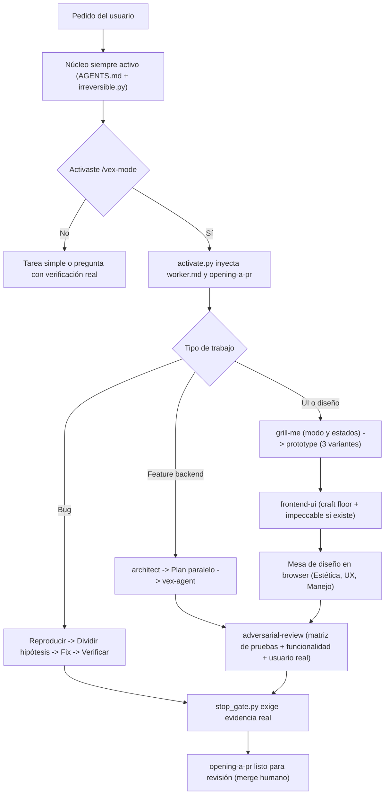

# Cómo se usa vex-mode en el día a día

vex-mode tiene dos niveles. El núcleo corre siempre, en cada sesión. El modo completo lo activas tú con un comando cuando la tarea lo merece. Esta página explica cuándo usar cada uno y qué pasa en cada caso de uso.

Los comandos están escritos para agy. En Claude Code agrega el prefijo `vex-mode:`, por ejemplo `/vex-mode:vex-mode` o `/vex-mode:why`.

## Lo que está siempre activo

Sin escribir ningún comando, cada sesión tiene estas reglas:

- **Primer mensaje.** El agente repite tu objetivo y el cambio más chico que lo cumple. Después avanza sin esperar tu permiso.
- **Autonomía.** El trabajo reversible avanza sin preguntar. Eso incluye editar archivos, crear ramas, correr tests y lanzar evals.
- **Pausa ante lo irreversible.** Un hook frena estos comandos y te pide confirmación: `git push --force` y sus variantes, un push a `main` o `master`, `gh pr merge`, `rm -rf` sobre rutas absolutas o del home, `terraform apply` y `destroy`, `kubectl delete` y SQL con `DROP` o `TRUNCATE`.
- **Respuestas cortas con evidencia.** Cada afirmación trae su prueba o una etiqueta: medido, inferido o suposición.
- **Cambiar código sin dejar restos.** Antes de la primera edición, el agente busca en todo el proyecto cada uso de lo que cambia. Si reemplaza algo, mueve todos los usos y borra lo viejo, sin alias ni wrappers.
- **Probar sobre lo real.** El agente verifica corriendo la feature o leyendo el valor real. "Compila" no cuenta como prueba.
- **Puede decir que no.** Si le preguntas si algo vale la pena, te da su juicio real, aunque sea "no".

Para tareas chicas, como una pregunta, un cambio de una línea o un comando suelto, el núcleo alcanza. No hace falta el modo completo.

## Cuándo activar el modo completo

Escribe `/vex-mode <tarea>` cuando la tarea tenga alguna de estas formas:

- Un bug que hay que reproducir y explicar.
- Una feature que toca más de un archivo o más de una función.
- Un refactor que debe mantener el comportamiento.
- Trabajo que termina en un PR.

Al activarlo pasan tres cosas:

1. El hook `activate.py` marca la conversación como activa y le da al agente la lista de lectura: `worker.md` y el playbook de abrir un PR. Después el agente lee el playbook de la tarea (bug fix o feature) y las skills de principios que ese playbook nombra.
2. El agente elige el playbook que corresponde a la tarea y copia sus pasos a la lista de tareas. Una limpieza o un refactor no tiene playbook propio: sigue las reglas del núcleo y las skills de principios.
3. Antes de terminar, el hook `stop_gate.py` le pide una vez por mensaje la evidencia de verificación. Si no la mostró, vuelve a trabajar. En Claude Code no lo pide si la última herramienta del turno fue un comando, porque ese comando ya es la verificación.

El modo dura toda la conversación. No hace falta repetir el comando en cada mensaje.

## Diagrama de flujo



## Un día común

Este ejemplo muestra un día con tres tareas en un mismo repo.

### Al empezar, prepara el repo una sola vez

Si el repo nunca tuvo agentes trabajando en él, ejecuta `/agent-ready` dentro del repo. Esto se hace una vez por repo, no cada día.

El agente deja:

- `AGENTS.md` con una tabla que une cada regla con lo que la hace cumplir.
- `scripts/check`, un solo comando que corre igual en local, en el hook y en CI.
- Un hook de Stop que corre `scripts/check` cuando el agente quiere terminar con cambios. Si falla, el agente recibe el error y lo arregla, hasta tres intentos por conversación.
- `verify-<app>`, una skill que maneja tu app como lo haría un usuario.
- `.github/workflows/check.yml` si el repo tiene remoto en GitHub.

Antes de entregar, el agente rompe algo a propósito y te muestra que el check lo detecta.

### Mañana: arreglar un bug

```
/vex-mode el endpoint /orders devuelve 500 cuando el carrito está vacío
```

1. El agente repite el objetivo y el cambio mínimo.
2. Reproduce el 500 él mismo. Solo te pide ayuda si no puede llegar al sistema, y te dice por qué.
3. Arma hipótesis y las descarta con evidencia hasta que queda una.
4. Planea el fix sin cambiar el contrato público.
5. Verifica con la misma reproducción del paso 2.
6. Ordena los commits con el test que falla antes del fix.
7. Abre un PR listo para revisión.

Tú revisas el PR y lo mergeas. El agente no puede mergear: el hook lo frena.

### Mediodía: una feature nueva

```
/vex-mode agrega exportar pedidos a CSV desde el panel de admin
```

1. El agente estudia el subsistema que toca.
2. Ejecuta `architect`, que propone dos formas de tipos y módulos y elige una.
3. Escribe el plan de paralelismo en cuatro puntos: qué bloquea, qué es independiente, qué estado se comparte y la división más chica que es segura.
4. Delega el código a subagentes `vex-agent` con alcance concreto.
5. Clasifica la feature con `adversarial-review`, corre las pruebas que corresponden a su tipo y lanza subagentes frescos que intenten romper la funcionalidad y recorrerla como usuario real.
6. Ordena los commits en unidades chicas y abre el PR.

Si quieres opinar sobre el diseño antes del código, ejecuta `/architect` primero y pasa a `/vex-mode` cuando el diseño te convenza.

### Tarde: limpiar código sin cambiar lo que hace

```
/vex-mode simplifica el módulo de descuentos, tiene tres caminos que hacen lo mismo
```

No hay un playbook de refactoring, así que el agente sigue el núcleo y las skills de principios:

1. Antes de la primera edición, busca en todo el proyecto cada uso del código que va a tocar, incluidos tests y documentación.
2. Unifica los tres caminos en uno, mueve todos los usos y borra los viejos, sin dejar wrappers.
3. Prueba sobre lo real que el comportamiento no cambió, por ejemplo comparando la salida de los mismos comandos antes y después.

### Al terminar el día: guardar lo aprendido

```
/reflect
```

El agente lee la conversación y busca correcciones que le diste, cosas que tuvo que descubrir y checks que se saltó. Te presenta tres listas: Aceptado, Rechazado y Backlog. No edita ninguna skill hasta que apruebes.

## Otros casos de uso

### Entender por qué algo es así

```
/why por qué el timeout del worker es 45 segundos
```

El agente responde desde el historial: commits, PRs y discusiones. Cita lo que escribieron los autores, marca sus inferencias como inferencias y dice qué no responde el registro.

### Un error que el agente repite

Cuando corriges al agente por el mismo error por segunda vez, ejecuta `/correct`. El agente agrupa los errores en clases y arregla cada clase al nivel más alto que funcione, en este orden:

1. Arquitectura, para que el error sea imposible.
2. Tipos o un lint cuyo mensaje nombra el arreglo.
3. Un test del comportamiento.
4. Documentación, solo para decisiones de criterio.

Cada check nuevo se prueba contra un error real del pasado.

### Trabajo de UI, frontend y diseño

Cuando una tarea toca interfaz o diseño bajo `/vex-mode`, el agente carga `frontend-ui` (y usa `impeccable` si está instalado en tu máquina):

1. Si usas `/grill-me` antes de construir, la entrevista incluye modo de superficie (`Persuade`, `Operate`, `Read`, `Experience`), dirección visual, acción primaria y estados borde.
2. Si la dirección visual está abierta, `/prototype` genera 3 variantes en `?variant=A|B|C` aplicando el piso visual anti-slop.
3. Durante la implementación, `frontend-ui` exige contraste legible, tipografía consistente, superficies del navegador tematizadas y los cinco estados (`loading`, `empty`, `error`, `disabled`, `overflow`).
4. Antes de cerrar, pasa por la **Mesa de diseño** sobre el navegador real (`browser` y `impeccable detect` si existe) validando Estética, UX y Manejo.

### Revisión adversarial al terminar una feature

Cuando cierras una feature bajo `/vex-mode` (o invocas `/adversarial-review`), el agente no se conforma con tests TDD unitarios:

1. Clasifica la feature según su tipo (`Backend`, `Frontend`, `Full-stack`, `CLI`, `Datos` o `Skills`) para correr los tipos de prueba que corresponden.
2. Despacha subagentes frescos que no escribieron el código: un **functionality breaker** (`vex-agent`) que intenta romper bordes, contratos y requisitos, un **browser breaker** (`browser`) si hay UI web, y un **real-user simulator** que recorre el flujo desde la entrada pública sin leer el código interno.
3. Cada defecto encontrado se delega a un `vex-agent` fresco y se vuelve a probar hasta quedar limpio (tope de tres rondas).

### Trabajo largo o desatendido

Si vas a dejar al agente trabajando solo, dilo en el mensaje: "no pares", "me voy a dormir" o "sigue hasta terminar". El agente sigue sin pausar en lo reversible. Lo irreversible sigue pausado.

Agrega `/show-me-your-work` para que deje un log TSV con una fila por decisión: qué hizo, por qué, la evidencia y el resultado. Cuando vuelves, lees el log en vez de la conversación entera. Lo renderizas en la terminal con `column -s$'\t' -t decisions.tsv`.

### Escribir tests primero

```
/tdd el redondeo de impuestos falla con montos negativos
```

Úsalo cuando el bug tiene un test local barato. El agente escribe el test, lo ve fallar por la razón correcta, aplica el fix y lo ve pasar. Si el test sería caro o frágil, usa otra verificación y te dice cuál.

### Revisar un texto

`/unslop` quita los patrones de texto generado por IA de cualquier texto. `/technical-writing` aplica el estándar de documentación a docs, READMEs, PRs y commits. En modo completo el agente usa los dos solo, sin que los pidas.

### Mantener la skill de verificación

`/maintain-verification-skill` revisa que `verify-<app>` siga coincidiendo con la app. Lee el código de cada feature, maneja la app en una sesión y abre como máximo un PR con correcciones probadas. Córrelo cada tanto o después de cambios grandes en la app.

## Qué decides tú y qué decide el agente

| Decide el agente sin preguntar | Pausa y te pregunta |
| --- | --- |
| Editar, crear y borrar archivos del repo | Force-push a ramas compartidas |
| Crear ramas y worktrees | Push a `main` o `master` |
| Correr tests, builds y evals | Mergear un PR |
| Abrir PRs listos para revisión | Deploys y `terraform apply` |
| Lanzar subagentes | Borrar datos o tablas |
| Elegir entre opciones reversibles | Mensajes a clientes o a personas fuera del trabajo |

Si el agente eligió algo reversible que no te gusta, corrígelo en el siguiente mensaje. Está diseñado para avanzar y dejar que tú corrijas, en vez de esperar tu respuesta.
