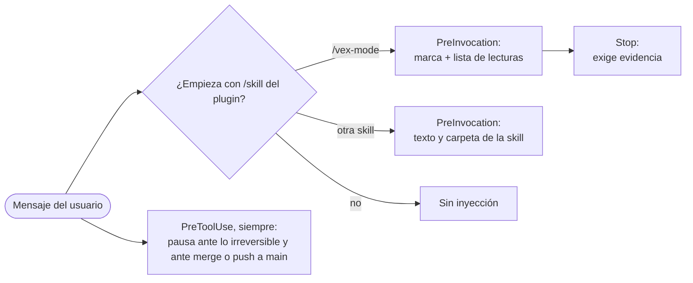
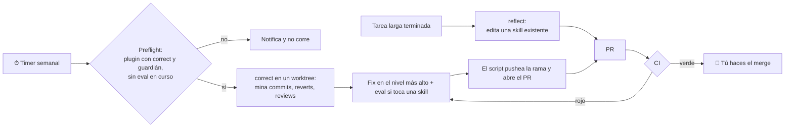

# vex-mode — Documento de diseño

- **Fecha:** 2026-11-18 · actualizado 2026-11-19
- **Estado:** aprobado e implementado: M1 a M4 (PRs #1 a #4). M5 (calidad del código, §8.2.1) aprobado e implementado; evidencia en `docs/decisions/2026-11-19-m5-quality.md`. Cada hito corrigió este documento tras releer sus fuentes.
- **Repo:** `~/Projects/VexOs/Code/Repos/vex-mode`, privado en GitHub (`JaraEsequiel/vex-mode`). Este archivo vive en `docs/specs/`; el HTML se genera con `python3 scripts/render_design.py`.

**Cómo leer las fuentes.** Cada decisión lleva su fuente entre corchetes. La tabla del final (§13) define cada código. Las etiquetas son:
- `[P-…]`: código de pstack (cursor/plugins, commit `35a9094`, con archivo y línea).
- `[T-…]`: charlas y entrevistas de Lauren Tan, vía transcripción o reseña.
- `[I-…]`: issues de GitHub.
- `[A-…]`: documentación de Antigravity embebida en agy 1.5.11.
- `[AUD]`: la auditoría con agentes y refutadores de esta sesión.
- `[VEX]`: decisión tuya en esta conversación.
- `[R-…]`: artículos e investigación (papers y notas de 2026), releídos el 2026-11-19.
- `[RUN]`: datos medidos en una corrida de eval guardada.
- `[MÍA]`: propuesta mía, corregible, sin fuente externa.

---

## 1. Intención

Construir un modo de trabajo personal para agentes. Se llama vex-mode, está fuertemente inspirado en pstack/poteto-mode y corre sobre Antigravity (agy CLI, IDE y app) `[VEX]`.

El repo es **AI-faced**: lo mantiene y lo mejora la propia IA `[VEX]`. La idea viene de la tesis de poteto: un repo preparado para agentes asume que cada contribuidor es un agente que solo ve los archivos que abrió, copia el ejemplo más cercano y toma el camino más corto que compila `[P-correct:11]` `[T-talk]`.

**Por qué no instalar pstack tal cual.** La auditoría mostró tres cosas `[AUD]`:
- Las ideas son buenas: diseño 7/10 tras la refutación.
- La ejecución falla, porque las reglas son prosa que los agentes ignoran. En 18 ejecuciones el agente leyó 0 veces los archivos de principios `[I-726]`. En otro programa con 93 delegados, solo 5 leyeron `no-comments` `[I-864]`.
- No hay evidencia publicada de que funcione: 2/10.

vex-mode toma las ideas y corrige la ejecución con estructura. Es la regla de la propia poteto: *"think about how you can make that a deterministic check instead of adding another line to your rules"* `[T-teamday]` `[P-encode]`.

## 2. Objetivos, no-objetivos y anti-objetivos

**Objetivos**
- Un router (`vex-mode`) que elige un playbook y copia sus pasos a la lista de tareas `[P-mode:108]`.
- Reglas que se cumplen por hooks y checks, no solo por texto `[P-correct:19-22]` `[T-talk]`.
- Un bucle de auto-mejora en el que cada corrección termina en estructura `[P-correct]` `[P-reflect]`.
- Evidencia de que funciona, con evals guardados y vinculados a la versión de cada skill `[AUD]`.
- Un generador `agent-ready` que prepara cualquier proyecto para recibir agentes `[T-talk]` `[P-verify]` `[P-correct]`.

**No-objetivos (por ahora)**
- Soportar varias herramientas: Claude Code, Codex o Cursor. Era el enfoque C y queda descartado por ahora `[VEX]`. Motivo: el port de pstack a Claude Code quedó en 5/10 por mantener adaptadores `[AUD]`.
- Paneles de revisión con modelos de varios vendors como requisito. Se decide al implementar, según los modelos que ofrezca agy `[MÍA]`.
- Publicarlo `[VEX]`.

**Anti-objetivos** (aunque funcione, sería un fracaso si…)
- Se vuelve un manual largo que nadie lee. *"When in doubt, delete. Keep only prose that changes a decision"* `[P-authoring:10]`.
- Tiene reglas que nada hace cumplir. Esto es exactamente lo que falló en pstack `[AUD]`.
- Aumenta el volumen de trabajo sin aumentar la confianza. *"if your inner coding loop produces slop, then automating that loop just produces more slop"* `[T-teamday]`.

## 3. Restricciones

- **Plataforma:** Antigravity. Un plugin es una carpeta con `plugin.json` y subcarpetas opcionales: `skills/`, `agents/`, `rules/AGENTS.md`, `mcp_config.json`, `hooks.json` y `assets/` `[A-plugin]`.
- **Formato:** `AGENTS.md` + `SKILL.md` estándar `[VEX]`. agy lee los dos `[A-plugin]` `[A-skills]`.
- **Hooks disponibles:** `SessionStart`, `PreToolUse`, `PostToolUse` y `Stop`. Reciben JSON con `hookEventName`, `cwd` y `toolCall.id` `[A-hooks]`.
- **Ubicaciones de hooks:** global (`~/.gemini/config/hooks.json`), dentro de un plugin, y en el workspace (`<repo>/.agents/hooks.json`, que solo se carga si la carpeta es confiable) `[A-hooks]`.
- **Validación nativa:** `agy plugin validate --strict` `[A-validate]`.
- **No tocar lo de Omarchy.** Las skills `omarchy`, `omarchy-app` y `diagnose-crash` viven en `~/.gemini/config/skills` y las gestiona Omarchy `[VEX]`.

## 4. Enfoques considerados

| | Enfoque | Gana | Cede |
|---|---|---|---|
| **A ✅** | El repo es un plugin de Antigravity, con dos AGENTS.md | Hooks reales, validación nativa, instalación con un comando | Queda atado a Antigravity. Las skills siguen siendo SKILL.md estándar y portables |
| B | Solo `AGENTS.md` + `.agents/skills/`, sin plugin | Funciona en cualquier herramienta | Sin hooks todo es prosa, y está demostrado que se ignora `[I-726]` |
| C | Núcleo portable + adaptadores por herramienta | Varias herramientas | Mantenimiento doble. El adaptador de pstack quedó en 5/10 `[AUD]` |

**Elegido: A** `[VEX]`. Es lo que pstack predica (*encode lessons in structure*) aplicado al propio modo, que es lo que pstack no hizo `[P-encode]` `[AUD]`.

## 5. Estructura del repo

```
vex-mode/
├── AGENTS.md                 § 6.1  para la IA que mantiene ESTE repo
├── README.md                 para humanos: qué es, cómo instalar
├── plugin.json               § 3    manifiesto del plugin
├── rules/AGENTS.md           § 6.2  núcleo mínimo cargado en tus sesiones
├── agents/vex-agent.md       § 6.4  definición del subagente
├── skills/
│   ├── vex-mode/             § 6.3  router
│   │   ├── SKILL.md
│   │   ├── worker.md         § 6.4  reglas que hereda cada subagente
│   │   └── playbooks/*.md
│   ├── principle-*/          § 6.5
│   ├── correct/  reflect/    § 9    auto-mejora
│   ├── show-me-your-work/    § 9    registro de decisiones
│   ├── create-verification-skill/   § 8.3
│   ├── maintain-verification-skill/ § 8.3
│   └── agent-ready/          § 10   prepara otros repos
├── hooks.json + hooks/       § 7.1  hooks del modo
├── checks/                   § 8.1  checks estructurales (deterministas)
├── evals/<skill>/            § 8.2  casos y resultados de evals (fuera de skills/)
├── evals/run.py              § 8.2  arnés que ejecuta candidatos y juez con agy -p
├── scripts/build_plugin.py   § 8.2  exporta solo las partes del plugin para instalar
├── scripts/scheduled_correct.py § 9 ejecución semanal de `correct` (timer de systemd)
├── vendor.lock               § 6.6  procedencia de lo copiado de pstack
├── LICENSES/pstack-MIT.txt   § 6.6
├── docs/
│   ├── specs/                este documento
│   └── decisions/            registro de decisiones del repo
└── .github/workflows/ci.yml  § 8.4
```

## 6. El modo

### 6.1 Dos audiencias, dos AGENTS.md
- **`AGENTS.md` en la raíz** es para el agente que **mantiene** vex-mode. Contiene la misión, el mapa del repo, cómo verificar un cambio y la **tabla regla → mecanismo que la hace cumplir** `[P-correct:28]`.
  - Cada regla nueva entra con su mecanismo. Si una regla ya existía y nada la hacía cumplir, es una reincidencia y se sube de nivel en el mismo cambio `[P-correct:28]`.
  - Cuando su error ya no puede ocurrir, la regla se borra `[P-correct:28]`.
- **`rules/AGENTS.md`** se carga en **tus** sesiones de trabajo, en cualquier proyecto `[A-plugin]`. Contiene solo el núcleo mínimo de §6.2.
- **El modo completo solo actúa al invocar `/vex-mode`** `[VEX]`. Esto incluye las lecturas, el gate de evidencia y los playbooks. Es fiel a poteto-mode, que solo se activa a mano (`disable-model-invocation: true`) `[P-mode:4]`.
  - Al invocarlo se escribe una **marca de sesión** que leen los hooks de §7.1.
  - Sin marca, los hooks del modo no hacen nada, salvo la pausa ante lo irreversible.
  - El formato de la marca (archivo por conversación o por `cwd`) lo decide el implementador `[MÍA]`.

### 6.2 Contenido del núcleo (`rules/AGENTS.md`)
- **Primer mensaje:** reformular el objetivo y el cambio mínimo que lo cumple, y seguir `[P-mode:19]`.
- **Autonomía:** lo reversible se hace sin preguntar; se pausa ante lo irreversible (force-push a ramas compartidas, deploys, borrado de datos, mensajes a clientes) `[P-mode:76-78]`.
- **"No" es una respuesta válida:** franqueza antes que complacencia `[P-mode:82]`.
- **Estilo:** frases cortas, cada afirmación con evidencia o etiqueta (medido, inferido o suposición), nunca pasarle al humano un check que podría ejecutar el agente `[P-mode:104]`.
- **Verificar contra el artefacto real**, nunca contra "compila" `[P-prove:9]`.

### 6.3 Router `vex-mode`
- Elige un playbook y copia sus pasos a la lista de tareas `[P-mode:108]`.
- Si una duda se resuelve ejecutando algo, se prototipa en lugar de preguntar `[P-mode]` (non-negotiables).
- **Lista de lecturas explícita por playbook.** Cada playbook nombra los archivos exactos que hay que leer. Es lo que demostró subir las lecturas: con una lista incondicional al inicio de cada playbook, 68 de 72 ejecuciones leyeron un principio, frente a 0 de 72 sin ella `[I-726]`. Nombrar la lectura en el kickoff hizo que 65 de 93 delegados leyeran el adaptador `[I-864]`. Leer no prueba calidad: nadie calificó las respuestas `[I-726]`.
- **Playbooks iniciales:** M1 empieza con 2, bug-fix y feature `[VEX]`. Los siguientes candidatos son investigation, refactoring y opening-a-pr. Se añaden solo cuando su patrón se repita 2 veces `[MÍA]`, con el criterio de *"a class counts once it has happened twice"* `[P-correct:15]`.
- **Sin skills de planificación por defecto.** *"the best spec is code"* `[P-readme:270]`.

### 6.4 Subagentes: `worker.md` y `vex-agent`
- Todo kickoff de un subagente empieza con `Read <ruta>/worker.md before anything else.` `[P-mode:20]`.
- `worker.md` contiene:
  - La vara del kickoff es toda la vara.
  - Nunca mostrarle una pregunta a una persona: decidir lo reversible.
  - Los PRs se abren listos para review, nunca en draft.
  - Título `type(scope): subject`.
  - Cuerpo con Why, What changed, Scope, Tradeoffs, Blast Radius y Verification.
  - Fuente: `[P-worker:4-10]`.
- **Refuerzo estructural (desviación):** el hook de activación `PreInvocation` (§7.1) inyecta la lista de lecturas, `worker.md` incluido, en vez de depender de que el kickoff lo pida `[I-864]` `[A-hooks]`.
- **Respaldo:** las reglas de `worker.md` también van en el cuerpo de `agents/vex-agent.md`, así llegan al subagente, que es una conversación aparte `[MÍA]` (`docs/decisions/2026-11-18-hook-probe.md`).
- **Subagentes nuevos por defecto:** cada reintento va a un agente nuevo con el brief original `[P-mode:100]`.
- **Modelo fijo en `vex-agent.md`:** solo si agy lo acepta como campo válido. pstack falló justamente por usar un nombre de modelo inválido `[I-1270]` `[AUD]`.

### 6.5 Principios
- Se usa la estructura de dos niveles de pstack: un índice con el disparador de cada principio dentro del router, y cada principio como una skill corta `[P-readme:224]`.
- **Cuáles entran:** se eligen al implementar. El criterio es que sobreviva a la auditoría y tenga un mecanismo que lo haga cumplir o un disparador claro `[AUD]` `[MÍA]`.
- **Candidatos fuertes:**
  - prove-it-works `[P-prove]`
  - fix-root-causes, laziness-protocol, subtract-before-you-add, sequence-verifiable-units
  - encode-lessons-in-structure `[P-encode]`
  - never-block-on-the-human
- **La regla de citar principios en cada respuesta queda fuera.** La auditoría mostró que los agentes citan principios sin haberlos leído `[I-726]` `[AUD]`.

### 6.6 Reutilizar pstack: copiar, nunca reescribir `[VEX]`
- **Toda skill que ya existe en pstack se copia tal cual**, con su carpeta completa. No se reescribe ni se parafrasea `[VEX]`. Lo mismo vale para cualquier cosa que ya exista: antes de crear algo, se busca si ya está hecho (skills de pstack, skills incluidas en agy, Omarchy) `[VEX]`.
- **Dos commits por skill, en orden:**
  1. `vendor: copy <skill> from pstack@35a9094`: la copia exacta, sin cambios.
  2. `adapt: <skill> for antigravity`: solo las adaptaciones.

  Así el diff muestra exactamente qué cambiamos y nada más `[MÍA]`, siguiendo el principio sequence-verifiable-units `[P-mode]`.
- **Qué se permite adaptar:** solo lo que no funciona en Antigravity. Eso es:
  - Rutas (`.cursor/` → `.gemini/` y `.agents/`).
  - Nombres de modelos.
  - Nombres de herramientas (`Task` → el equivalente en agy).
  - Referencias a `cursor-team-kit` y a funciones exclusivas de Cursor.

  Todo lo demás queda igual `[VEX]` `[MÍA]`.
- **Procedencia:** un `vendor.lock` en la raíz registra, para cada skill copiada, el repo, el commit, la ruta original y el hash del original `[MÍA]`.
- **Licencia:** pstack es MIT, *"Copyright (c) 2026 Lauren Tan"*. El aviso se conserva en `LICENSES/pstack-MIT.txt` `[P-license]`.
- **Cómo se hace cumplir** `[P-encode]`:
  - Un check en CI exige que cada skill copiada tenga su entrada en `vendor.lock`.
  - `scripts/upstream_drift.py` compara cada archivo de `vendor.lock` contra pstack upstream y lo clasifica: sin cambios, cambiado o borrado. Si el archivo está adaptado, muestra el diff de upstream desde el commit de ese archivo, para reaplicarlo sobre la adaptación en vez de pisarla `[MÍA]` `[VEX]`.
  - `vendor.lock` guarda el commit de origen **por archivo** (`upstream_commit`); el commit global queda como valor por defecto de las entradas viejas `[MÍA]`.
  - Un workflow semanal de GitHub Actions corre el script y mantiene un único issue, "pstack upstream drift": lo abre o actualiza si hay cambios y lo cierra cuando no queda ninguno. No hace fallar el CI de los PRs, porque un cambio upstream no es un error nuestro `[VEX]`.
  - La regla entra en la tabla del `AGENTS.md` raíz con ese check como mecanismo `[P-correct:28]`.

## 7. Hooks

### 7.1 Hooks del modo (en el plugin)
Controlan **cómo trabaja el agente**, sea cual sea el proyecto `[VEX]` `[A-hooks]`.

| Hook | Qué hace | Cuándo actúa | Fuente de la regla |
|---|---|---|---|
| `PreInvocation` | Con `/vex-mode`: marca la sesión e inyecta una vez la lista de lecturas (con `worker.md`). Con cualquier otro `/<skill>` del plugin: inyecta su texto y su carpeta, una vez por mensaje | Con `/<skill>` del plugin `[VEX]` | `[P-mode:20]` + el fallo documentado en `[I-726]` + `[A-probe-slash]` |
| `PreToolUse` | **Pausa y pide confirmación** ante lo irreversible (force-push a ramas compartidas, deploy, borrado de datos). No bloquea sin salida | **Siempre** | `[P-mode:78]` ("Always pause", no "prohibir") `[MÍA]` |
| `Stop` | No deja cerrar una tarea sin evidencia de verificación | Solo con la marca de `/vex-mode` `[VEX]` | `[P-prove:9]` |

El mecanismo del hook `Stop` se prototipó antes de fijarlo, como indica `[P-mode]`: lo que se puede decidir ejecutando algo, se prototipa. El resultado está en `docs/decisions/2026-11-18-hook-probe.md`. En agy, `{}` en `PreToolUse` deniega y `force_ask` en `agy -p` no ejecuta el comando y termina el turno `[A-hooks]`.



### 7.2 Hooks de cada proyecto (en cada repo, no en vex-mode)
- Las reglas del código de un proyecto viven en **lint + CI de ese proyecto**, no en hooks. Un hook solo corre cuando usas Antigravity, mientras que CI aplica a cualquiera: humano, Claude Code u otro agente `[P-correct:26]` `[T-talk]`.
- El hook del proyecto es mínimo: un `Stop` que, si hay cambios, ejecuta el `check` del repo y, si falla, devuelve `continue` con el error, así el agente lo arregla antes de terminar. No es `PostToolUse` porque agy ignora su salida (espera `{}`); `Stop` con `continue` sí llega al agente, probado en un workspace con `agy -p` `[A-hooks-doc]` `[A-probe-m4]`. Un contador propio limita los reintentos, porque `continuationActive` no funciona en agy `[VEX]`.
- Lo genera `agent-ready` (§10). vex-mode no trae hooks de proyecto `[VEX]`.

## 8. Verificación y evals, en tres niveles

`[VEX]` aprobó los tres puntos de esta sección.

### 8.1 Checks estructurales de cada skill → `checks/` en vex-mode, en CI
- Son deterministas y baratos. *"Test cases if structural. Skip if subjective"* `[P-authoring:7]`.
- Qué revisan:
  - El frontmatter tiene `name` y `description`.
  - Los archivos referenciados existen y los enlaces resuelven `[P-authoring]`.
  - Las rutas que nombra la lista de lecturas existen `[I-726]`.
  - Cada regla de la tabla del `AGENTS.md` raíz apunta a un mecanismo que existe en el repo. Es la regla que pstack predica y no se aplica a sí mismo `[P-encode]` `[AUD]`.
  - Presupuesto de tamaño por skill `[P-authoring:10]` `[MÍA]`.

### 8.2 Evals de comportamiento → `evals/<skill>/` en vex-mode, fuera de `skills/`

*Revisado el 2026-11-18 tras releer las fuentes (§13) y probar agy 1.5.11 `[A-cli]`.*

- **Para qué:** *"A skill is a process you measure, and then you make shorter."* `[T-robson]`. Un eval es *"a unit test for an agent"* `[T-talk]` `[T-maily]`.
- **Por qué fuera de la carpeta de la skill:** el candidato no puede ver ningún directorio, archivo o prompt con `eval`, `test`, `judge`, `rubric`… `[P-eval:7]`. La carpeta de una skill es lo que el agente carga, así que una rúbrica guardada ahí contamina el resultado.
- **Qué se reutiliza:** el playbook `eval.md` se copia tal cual de pstack y se adapta a agy `[P-eval]` `[VEX]`.
  - Sus pasos 4 y 5 delegan en `arena` (fases B y C) para lanzar candidatos y juez `[P-eval:20-21]`. En agy esas dos fases las ejecuta un arnés determinista, `evals/run.py`, con `agy -p`, porque así el modelo de cada candidato queda fijado por flag (`--model`) `[A-cli]` `[MÍA]`.
  - `arena` no se copia en M2. La referencia queda en `removed_refs` para restaurarla cuando se traiga como skill de diseño `[MÍA]`.
  - `principle-explain-the-number` se copia, porque fija cómo leer el número de un eval: cuántas ejecuciones, la dispersión y si la diferencia supera el ruido `[P-explain]`.
- **Método** (el de pstack):
  - Entornos sanitizados.
  - Un prompt que parezca una petición real.
  - Un juez ciego de otra familia de modelos, llamado por API `[P-eval:21]` `[VEX]`.
  - La cadena se verifica con los transcripts, no con lo que el agente dice de sí mismo `[P-eval:22]`.
- **El juez es de otra familia y se llama por API, no por agy** `[VEX]` `[P-eval:21]`. Los candidatos siguen corriendo con `agy -p`; el juez no es un agente, solo lee el material y devuelve el veredicto, así que va directo a la API del proveedor `[VEX]`.
  - **Configurable:** `evals/judge.json` (versionado) fija `provider` (`openai`, `anthropic` o `agy`), `model` y `effort`. `VEX_JUDGE_PROVIDER` y `VEX_JUDGE_MODEL` lo pisan para una corrida puntual. Por defecto: `openai`, `gpt-6.2-sol`, effort `medium` `[VEX]`.
  - **API key:** nunca en el repo. Se lee de la variable del proveedor (`OPENAI_API_KEY`, `ANTHROPIC_API_KEY`) o, si no está, de `~/.config/vex-mode/secrets.env` (permisos 600), que también usa el timer semanal `[VEX]` `[MÍA]`. La raíz de la API (`VEX_OPENAI_BASE_URL`, `VEX_ANTHROPIC_BASE_URL`, para un servidor compatible) sale del mismo lugar y en el mismo orden; un `secrets.env` ilegible hace fallar el eval antes de lanzar candidatos `[MÍA]`.
  - **Por qué salió de agy:** en M4 el juez por agy falló tres veces por el harness, no por el modelo: un prompt de 213 KB como argumento (`E2BIG`), la lectura denegada fuera de su workspace y la cuota de Claude agotada `[A-probe-m4]` (`docs/decisions/2026-11-19-m4-eval.md`).
  - **Salida estructurada:** OpenAI Responses API con `text.format` `json_schema` y `strict` `[A-openai-so]`; Anthropic Messages API con `output_config.format` `[A-anthropic]`. El arnés igual valida cada etiqueta y criterio (§8.2, `judge.check_verdict`).
  - El arnés rechaza un juez de la misma familia que los candidatos.
- **Transcripts:** cada ejecución se guarda con `agy -p --output-format stream-json`. Ese formato registra cada `read_file` y `run_command` con su ruta, y el uso de tokens `[A-cli]`. El juez devuelve un veredicto estructurado con el JSON schema de la API de su proveedor.
- **Cuatro medidas por ejecución, no solo cumplimiento** `[I-1178]` `[VEX]`:
  1. **Cumplimiento:** la rúbrica de 3 a 6 criterios, calificada por el juez `[P-eval:17]`.
  2. **Resultado:** un script de comprobación del caso, que se ejecuta en el directorio del candidato después de la ejecución y nunca se le muestra.
  3. **Costo:** tokens y duración, tomados del evento `result` del transcript.
  4. **Calidad:** solo sobre las ejecuciones que pasan el resultado (§8.2.1, M5).
- **Una sola palanca por comparación** `[I-1178]`. Cada caso corre tres brazos:
  - A: la skill base (la de `main`).
  - B: la variante.
  - C: la base con un modelo mejor (línea base de "solo cambiar de modelo").
  - A↔B cambia solo la skill; A↔C cambia solo el modelo. El arnés construye los brazos; el caso no puede definir otros.
- **Lectura del número** `[P-explain]`: por defecto 3 ejecuciones por brazo. El resultado guarda la media y la dispersión de cada medida, y la señal sale de una prueba de una cola (α = 0,05) cuya p se guarda junto a ella (`<medida>_p`) `[MÍA]`. La regla anterior (ruido si la dispersión supera la diferencia) se descartó: una sola ejecución en cada extremo estiraba la dispersión, y cumplimiento 0,90 contra 0,50 en 10 ejecuciones se leía como ruido. Las medidas continuas (cumplimiento, tokens, tiempo y calidad) usan Mann-Whitney exacto, con rangos medios en los empates; con 3 ejecuciones por brazo la mejor p posible es justo 0,05. El resultado (pasa o no pasa) usa la prueba exacta de Fisher y guarda su p en `outcome_p`. Con 3 ejecuciones ni 3 de 3 contra 0 de 3 baja de 0,05; un caso que debe mostrar una diferencia de pasar necesita unas 10 por brazo (con 100 % contra 40 %, la detecta 95 de cada 100 veces).
- **Aislamiento del candidato** `[I-877]` `[A-cli]`:
  - agy carga los plugins globalmente, y `--settings` no puede apagarlos por sesión `[A-cli]`. Además, el hook de activación inyecta rutas absolutas del plugin instalado. Por eso cada brazo **instala su variante del plugin** antes de sus ejecuciones, y el arnés reinstala la original al terminar, también si falla.
  - `agy plugin install <dir>` copia la carpeta entera, incluidos `.git`, `docs/` y `evals/` `[A-cli]`. Un candidato podría leer las rúbricas. Por eso se instala siempre desde `scripts/build_plugin.py`, que exporta solo las partes del plugin (`plugin.json`, `skills/`, `agents/`, `rules/`, `hooks.json`, `hooks/`, `LICENSES/`).
  - Antes de calificar, el arnés verifica en el transcript qué copia se leyó: toda lectura de archivos de la skill debe venir del plugin instalado con el hash del brazo. Si no, la ejecución se invalida.
  - Los proyectos de los candidatos viven en un directorio de trabajo con nombre de proyecto, fuera del repo.
- **Los evals corren en local** con tu sesión de agy, no en CI. CI solo comprueba el hash `[MÍA]`.
- **Mejora sobre pstack:** se guarda cada resultado. pstack no publica ninguno `[AUD]`. Se versiona un resumen JSON por eval en `evals/<skill>/results/`; los transcripts completos quedan en local, por tamaño y privacidad `[MÍA]`.
- **Política de CI (aprobada `[VEX]`):** un PR que modifica una skill tiene que incluir un resultado de eval para esa versión. Los evals no se ejecutan en cada PR, por costo.
  - El hash cubre **toda la carpeta de la skill** (`SKILL.md`, playbooks y archivos auxiliares), no solo `SKILL.md`, porque los playbooks también cambian el comportamiento `[MÍA]`.
  - CI calcula qué skills cambiaron respecto de `main` y exige, para cada una, un resultado con el hash actual.
  - **Exención explícita:** un resultado de tipo `waiver` con motivo, para cambios donde un eval no mide nada (por ejemplo, una skill que solo dirige el propio eval). La exención queda visible en el PR y la aceptas o rechazas tú `[MÍA]`.
- **Formato de un caso:** `evals/<skill>/cases/<caso>/` con `prompt.md` (lo que vería el candidato), `rubric.md` (solo para el juez), `project/` (el proyecto que se copia al candidato), `check.py` (la comprobación de resultado) y `case.json` (modelos de los candidatos y número de ejecuciones; el juez es global, en `evals/judge.json`). Un check estructural impide palabras delatoras en `prompt.md`, en `project/` y en los nombres de directorio que ve el candidato `[P-eval:7]`.

### 8.2.1 Calidad del código (M5)

*Agregado el 2026-11-19 tras releer las fuentes `[R-…]` (§13) y medir los diffs de la corrida `20261119-145054-789891` `[RUN]`.*

- **Para qué:** pasar el check no alcanza. En 296 PRs que pasaban el grader de SWE-bench, cuatro mantenedores que no sabían el origen mergearon en promedio 24,2 puntos menos (error estándar 2,7). Entre los motivos de rechazo está *"The code is verbose, does not conform to standards"* `[R-metr]`. Hay parches que pasan los tests y aun así degradan una firma pública o ponen la lógica en el nivel equivocado `[R-milestone]`.
- **Criterios** `[VEX]`: el menor código necesario, reutilizar, nada de sobreingeniería ni comentarios, nada de AI slop, seguridad y código simple.
- **Solo entre las ejecuciones que funcionan** `[VEX]`:
  - En `tax-rounding`, el parche más chico (B, 5 a 6 líneas) era el roto: pasaba todo a `Decimal` y rompía a quien llamaba con `float` `[RUN]`. Medir "menos código" por separado premia la solución rota.
  - La calidad de una ejecución se calcula solo si es válida y su `outcome` es 1. La de un brazo resume esas ejecuciones y es `null` si ninguna pasa.
- **Comparación entre brazos, sin parche de referencia** `[VEX]`:
  - A↔B ya es una comparación relativa, así que ningún caso necesita un `reference.diff`.
  - La razón de desvío contra una referencia `[R-l2c]` se descarta por tres motivos: alguien tendría que escribir la referencia, ese autor sería otro sesgo y el paper no define cómo cuenta |Δ|.
- **Solo biblioteca estándar** `[VEX]`: `ast`, `tokenize` y `difflib`. No se usan `bandit`, `ruff` ni `ast-grep`. El costo es que las reglas son nuestras y nadie las validó fuera de este repo.
- **Qué se mide.** Lo hace `evals/harness/quality.py` a partir de `project/` del caso y el diff guardado de cada ejecución, así que también se recalcula sobre corridas viejas. Las medidas de código leen solo archivos `.py`.

| Medida | Cómo | Criterio | Fuente | Mejor | ¿Bloquea? |
|---|---|---|---|---|---|
| `prod_lines` | Líneas agregadas fuera de los tests (las borradas no cuentan, ver abajo) | menor código | `[R-trim]` (len(P)) `[MÍA]` | menos | sí |
| `test_lines` | Lo mismo en tests (`test_*.py`, `*_test.py`, `tests/`) | — | `[RUN]` | — | no, informativa |

Un script que el candidato deja suelto (`repro.py`, `debug_*.py`) cuenta como producción y, como el check no lo usa, como removible. TRIM encontró que los scripts de reproducción sueltos son el 49,6 % de las líneas removibles `[R-trim]`. Reproducir el error no exige dejar el archivo en el proyecto `[MÍA]`.
| `removable_lines` | Líneas de producción agregadas que se pueden quitar sin que falle el `check.py` oculto (ver abajo) | menor código, slop | `[R-trim]` | menos | sí |
| `complexity_delta` | Σ CC(f)·√SLOC(f) sobre las funciones de los archivos tocados, después menos antes | sobreingeniería, simplicidad | `[R-slopcode]` (masa) | menos | sí |
| `verbosity` | (Líneas agregadas que marca una regla ∪ líneas clonadas) ÷ líneas agregadas de producción | AI slop | `[R-slopcode]` | menos | sí |
| `comments_added` | Comentarios `#` en líneas agregadas (`tokenize`) | sin comentarios | `[VEX]` | 0 | sí |
| `docstrings_added` | Docstrings nuevos | — | `[MÍA]` | — | no, informativa |
| `security_findings` | Hallazgos nuevos de las reglas de seguridad (después menos antes) | seguridad | `[R-anthropic]` `[R-patchbench]` | 0 | sí |
| `judge_reuse`, `judge_simplicity`, `judge_contract` | Votos del juez de calidad (ver abajo) | reutilizar, simplicidad | `[R-anthropic]` `[R-l2c]` `[R-milestone]` | más | sí |

- **`removable_lines`, al estilo TRIM** `[R-trim]`:
  - Según TRIM, CodeSlop = len(parche) − len(parche mínimo que sigue cumpliendo la tarea), con los tests como oráculo. TRIM quita entre 17,9 % y 32,9 % de los parches de agentes.
  - Acá el oráculo es el `check.py` oculto, que corre en milisegundos. Se hace una pasada por bloque de `difflib` y otra por línea (TRIM-NG, O(n) corridas del check), siempre de atrás hacia adelante. Una unidad se revierte solo si el check sigue pasando.
  - Cubre solo producción: el check nunca ejercita los tests del candidato, que siempre saldrían "removibles".
  - Límite: la medida no puede ser mejor que el check. Si el check es débil, cuenta como removible código que sí sirve.
  - Solo cuentan las líneas agregadas, acá y en `prod_lines` `[MÍA]`. TRIM mide len = agregadas más borradas, pero en un caso de limpieza borrar la API vieja es la tarea: en `points-cleanup` las líneas borradas eran dos tercios de `prod_lines` en cada ejecución que pasó, y volver a poner el código borrado contaba como "removible" (de 6 a 14 líneas por ejecución, contra 1 a 4 sin eso). Restaurar código no es quitarlo, así que nunca se prueba revertir un borrado puro. Si borrar algo rompe la tarea, ya lo dice el check.
  - Un bloque reemplazado se revierte entero o no se revierte: código muerto pegado a un cambio necesario cae en el mismo bloque de `difflib` y no cuenta como removible.
- **Complejidad:**
  - CC se calcula con `ast`, con las reglas de radon `[R-slopcode]`, y se pondera por √SLOC, igual que la masa de SlopCodeBench.
  - La erosión del paper solo suma funciones con CC > 10, así que en un parche chico da 0 siempre `[RUN]`. Por eso se usa la variación de la masa. La erosión completa queda para el caso de varias etapas.
- **Verbosidad:**
  - Las 137 reglas de SlopCodeBench no aparecen publicadas en el paper, que solo remite a scbench.ai `[R-slopcode]`.
  - Escribimos un juego chico a partir de sus ejemplos y de los nuestros `[MÍA]`:
    - una lista armada con un bucle y `append` que podría ser una comprensión;
    - una guarda de lista vacía antes de iterar;
    - un nombre intermedio que se usa una sola vez y se devuelve;
    - `== True`, `== False` o `len(x) == 0`;
    - un `else` después de `return`;
    - un `except` que solo hace `pass`.
  - Clones: ventanas de 3 líneas normalizadas que se repiten en el archivo.
- **Seguridad** `[MÍA]`:
  - Las reglas en AST marcan:
    - `eval` y `exec`;
    - `shell=True`, `os.system` y `os.popen`;
    - `pickle.loads` y `marshal.loads`;
    - `yaml.load` sin `SafeLoader`;
    - `verify=False`, `CERT_NONE` y `_create_unverified_context`;
    - `tempfile.mktemp`;
    - `hashlib.md5` y `hashlib.sha1`;
    - un literal asignado a un nombre que contiene `key`, `secret`, `token` o `password`.
  - Anthropic pone el análisis estático de seguridad como segunda capa `[R-anthropic]`. PatchBench muestra que una sola validación sobreestima mucho: la tasa de éxito pasa de más de 97 % a "roughly half" con validación semántica `[R-patchbench]`. Estas reglas son un piso, no una prueba.
- **Juez de calidad:**
  - **Una dimensión por llamada.** Anthropic: *"grade each dimension with an isolated LLM-as-judge"* `[R-anthropic]`. RuVerBench: con 4 o 5 rúbricas en una llamada, todos los modelos pierden puntaje, a menudo dos dígitos `[R-ruver]`.
  - **Tres dimensiones:**
    - `reuse`: ¿usa lo que el proyecto ya tenía en vez de duplicar su lógica? `[VEX]`
    - `simplicity`: ¿es el cambio más simple que resuelve el pedido, sin abstracciones, configuración ni generalidad que nadie pidió? `[VEX]` `[R-l2c]` (Q3: *"code conciseness and absence of over-engineering"*)
    - `contract`: ¿quien ya llamaba a lo que cambió sigue funcionando (firmas, tipos aceptados y devueltos), salvo que el pedido exigiera otra cosa? `[R-milestone]` (*API Signature Degradation*)
  - **Qué recibe cada llamada:**
    - Todos los parches que pasan, ciegos y con etiquetas mezcladas, como el juez de cumplimiento.
    - Los archivos originales que tocaron, para poder juzgar la reutilización.
    - Así son 9 llamadas por eval y no 81 `[MÍA]`. RuVerBench mide el costo de juntar rúbricas en una llamada, no el de juntar ejecuciones.
  - **Respuesta:** `pass`, `fail` o `unknown` (*"return 'Unknown' when it doesn't have enough information"*) `[R-anthropic]`. RuVerBench fuerza respuestas binarias; elegimos la salida de Anthropic y contamos `unknown` como voto ausente `[MÍA]`.
  - **Votos:** 3 por dimensión. Una ejecución saca `pass` o `fail` solo si al menos 2 votos coinciden; con `pass, unknown, unknown` o `pass, fail, unknown` queda `null` `[MÍA]`. Según RuVerBench, la mejora llega *"mostly … within three to five votes"*, y votar *"reinforces the wrong label"* cuando el juez acierta menos de la mitad `[R-ruver]`. Si no hay mayoría, o todos los votos son `unknown`, el resultado es `null`. Como votar no corrige un error sistemático, el juez se calibra después (abajo).
  - **Qué juez:** el mismo de cumplimiento (`evals/judge.json`, hoy `gpt-6.2-sol`), de otra familia `[VEX]`. Ningún modelo Claude.
- **Cómo se lee:**
  - Cada medida guarda media y dispersión por brazo, y su señal B↔A y C↔A con la regla de §8.2 `[P-explain]`.
  - Una señal de calidad necesita al menos 2 ejecuciones con valor (que pasaron, y en el juez, que no quedaron en `null`) en cada brazo. Si no las hay, vale `"few"` y no bloquea `[MÍA]`. Con una sola ejecución no hay comparación que leer.
  - Si una medida no se pudo calcular (el check se colgó, una llamada del juez falló o devolvió etiquetas de más o de menos), su señal vale `"error"` y el motivo queda en `quality.errors` del resultado `[MÍA]`. Un error de calidad no invalida el resultado, porque 1 llamada fallida de 9 no justifica tirar 9 ejecuciones. Bloquea `promote` hasta que `rejudge` lo resuelva. Así, una API inestable no saca la calidad de la decisión en silencio.
- **Cómo entra en el veredicto** `[VEX]`:
  - `run.py verdict … promote` se rechaza si `signals.B_vs_A` marca `worse` en `outcome`, o `worse` o `"error"` en una medida que bloquea. `reject` e `inconclusive` no cambian. Es la regla "promover solo si ni el resultado ni la calidad empeoran", puesta como estructura y no como prosa.
  - `checks/check_evals.py` aplica la misma regla en CI a todo resultado con `promote`, para que editar el JSON a mano no la saltee. También exige las medidas de calidad en los resultados de casos con calidad fechados desde 2026-11-20 `[MÍA]`. Los resultados anteriores no las tienen y no se pueden recalcular: una corrida no guardó `diffs/` y la otra ya no existe. Esos quedan como están.
- **Qué casos la usan:**
  - `case.json` la activa con `"quality": true`. `tax-rounding` la activa.
  - `habit-tracker` todavía no, porque su salida son sobre todo plantillas copiadas y ahí "menos código" no mide nada `[MÍA]`.
- **`rejudge`** recalcula también la calidad (medidas y juez) sin correr de nuevo. También vuelve a comprobar el aislamiento de cada ejecución con las reglas actuales, así que un falso positivo corregido después del eval ya no anula la ejecución; el resultado (pasa o no pasa) sale del check guardado. Si la transcripción no trae el directorio de trabajo, mantiene el motivo guardado `[MÍA]`.
- **Costo:** el check corre unas O(líneas del parche) veces por ejecución, y el juez hace 9 llamadas más por eval.
- **Evaluar la evaluación** `[VEX]`:
  - **En M5, parches plantados:** cada medida que bloquea tiene un test con el arreglo correcto de `tax-rounding` y una versión empeorada a propósito: con comentarios, con código muerto, con `shell=True`, duplicada o con una abstracción de más. La versión empeorada tiene que puntuar peor (es la idea de exigir una rotura deliberada por medida `[I-1271]`). El juez se prueba con respuestas falsas, sin llamar a la API.
  - **Después de M5:** calibrar el juez de calidad contra vos con parches de las corridas guardadas calificados a mano `[R-anthropic]` (*"closely calibrated with human experts"*), y un caso de varias etapas para medir degradación `[R-slopcode]`. Según SlopCodeBench, pedir calidad en el prompt baja el punto de partida pero no la velocidad de degradación.
- **No-objetivos:**
  - No reemplaza leer los diffs y los transcripts (*"You won't know if your graders are working well unless you read the transcripts"*) `[R-anthropic]`.
  - No produce un puntaje único.
  - No mide el estilo del repo.

### 8.3 Verificación de cada proyecto → en cada repo de proyecto
- vex-mode trae `create-verification-skill`, que genera en cada proyecto un `verify-<app>` con estas partes: launch, doctor, drive, evidence, cleanup y un feature map `[P-verify:3]` `[P-verify:34]`.
- Un skill generado que nunca se ejecutó es solo un borrador `[P-verify:40]`.
- **Además tiene que demostrar que puede fallar.** Por cada feature que recorre, rompe a propósito ese comportamiento, exige que el recorrido falle en la afirmación que lo nombra y registra la rotura en la sección `## Breaks` del archivo de la feature. `maintain-verification-skill` vuelve a ejecutar esas roturas en los recorridos que cambia. En el issue, las skills generadas dejaban pasar 7 de 12 roturas; con este paso atraparon 16 de 16 `[I-1271]`.
- El skill generado vive en `.agents/skills/verify-<app>/`, la ubicación de skills de workspace en agy `[A-skills]`.
- Es lo que permite el automerge en Dune: *"Without verification skills, you become the verifier"* `[T-maily]` `[T-talk]`.

### 8.4 CI de vex-mode
`agy plugin validate --strict` `[A-validate]` + `checks/` + la política de evals de §8.2.

## 9. Bucle de auto-mejora (lo que hace al repo AI-faced)



1. **`correct`:** mina commits, reverts y reviews, y agrupa los errores en clases (una clase cuenta cuando ocurrió 2 veces). Cada clase se arregla en el nivel más alto que funcione: arquitectura, después tipos y lint, después test, y docs al final. Cada check nuevo tiene que demostrar que falla con un error real del pasado `[P-correct:15-26]`.
2. **`reflect`:** al terminar una tarea larga, convierte lo aprendido en una edición concreta de una skill existente. Un hallazgo solo se guarda si seguirá siendo cierto en 6 meses `[P-reflect:13]`.
   - Lee el transcript completo de la conversación, que agy guarda en `<directorio de artefactos>/.system_generated/logs/transcript.jsonl` y nombra en el prompt del agente. Como el archivo es completo, lo que una compactación resumió sigue ahí `[P-reflect:11]` `[A-transcript]` `[I-875]`.
   - **Destino de la edición:** si la skill es de vex-mode, la edita en un worktree del repo y abre un PR que mergeas tú, siguiendo "How to change a skill" del `AGENTS.md`. Si es de otro plugin, sigue a pstack: edita una copia en `.agents/skills/<skill>/` o `~/.gemini/config/skills/<skill>/` y nunca abre PRs `[P-reflect:17]` `[A-skills]` `[VEX]`.
3. **`show-me-your-work`:** guarda las decisiones en `decisions.tsv` `[P-smyw:46]`. Por defecto no se commitea; se commitea cuando un revisor necesita el rastro para confiar en el resultado `[P-smyw:48]`. En este repo, un rastro commiteado va en `docs/decisions/<fecha>-<tema>.tsv`, porque el repo vive de su propio historial `[MÍA]`.
   - La auditoría del final lee el transcript de agy de esa conversación `[P-smyw:57]` `[A-transcript]`.
   - La revisión cruzada del rastro usa `agy --model <modelo de otra familia> -p "<prompt>"`, igual que el juez de los evals `[P-smyw:67]` `[I-1159]` `[A-cli]`.
4. **Cómo entra un cambio:** como PR desde un worktree, con la plantilla de `worker.md`. Solo entra si pasa CI (§8.4) y, cuando toca una skill, el eval (§8.2) `[P-worker]` `[VEX]`.
5. **Disparo programado, y el merge lo haces tú** `[VEX]`.
   - Una ejecución periódica corre `correct` sobre el historial reciente y deja PRs.
   - **Ningún PR de la IA se mergea solo.** Es el primer peldaño de la escalera de confianza de poteto: el automerge se gana después, con evidencia acumulada `[T-maily]` `[T-talk]`.
   - **Mecanismo:** un timer de systemd de usuario, semanal (domingo 03:00, `Persistent=true`), que ejecuta `scripts/scheduled_correct.py` en local, porque GitHub Actions no tiene tu sesión de agy `[VEX]` `[MÍA]`.
   - El script crea un worktree desde `origin/main` en una rama `correct/<fecha>` (sin upstream) y ejecuta `agy --model … -p "/correct …"` sobre los commits y PRs de los últimos 7 días.
   - **El agente solo commitea.** El push de la rama y el `gh pr create` los hace el script al terminar, así el agente nunca necesita una vía hacia `main` `[VEX]` (revisión final de M3).
   - **Antes de empezar, el script se niega** si el plugin instalado no tiene `correct`, si su hook de pausa no bloquea `gh pr merge`, o si un eval tiene el plugin reemplazado. Avisa con una notificación en cada fallo y conserva el worktree si quedó trabajo sin commitear.
   - Si `correct` cambia una skill, un hook o una regla, la misma ejecución corre el eval (§8.2) y deja el resultado en el PR, así el CI del PR pasa sin que intervengas `[VEX]`.
   - El rastro de decisiones de la ejecución se commitea en el PR (`show-me-your-work`), porque nadie la vio correr `[P-smyw:48]`.
   - **Qué hace cumplir "no se mergea solo":** que el agente no pushea (lo hace el script) y el hook de pausa, que trata `gh pr merge`, los merges por `gh api` y cualquier push a `main` como irreversibles. El repo es privado sin GitHub Pro, así que no hay protección de rama del lado del servidor. En `agy -p` un `force_ask` no se ejecuta, porque no hay humano que confirme `[A-hooks]` (`docs/decisions/2026-11-18-hook-probe.md`).
   - **Costo conocido:** el eval reemplaza el plugin instalado mientras corre (unos 70 minutos). Si el timer se pone al día al iniciar sesión, una sesión tuya de agy en ese rato ve la variante; el arnés restaura tu plugin al terminar.
6. **Nunca sobreajustar** a una sola conversación: hacen falta varias repeticiones para convertir algo en regla `[P-automate:87]`.

## 10. `agent-ready`: el generador para otros repos

Aplica la tesis de poteto sobre repos preparados para agentes `[T-talk]` `[T-redreamality]`. Genera en el proyecto destino:
- Un `AGENTS.md` con la tabla regla → mecanismo `[P-correct:28]`.
- Un `verify-<app>`, mediante `create-verification-skill` `[P-verify]`.
- Un script `check` que corre igual en local y en CI `[P-correct:26]`.
- Un `.agents/hooks.json` con un `Stop` que ejecuta ese `check` cuando hay cambios y le devuelve el error al agente (§7.2) `[A-hooks-doc]` `[A-probe-m4]` `[VEX]`.
- Si el repo tiene un remoto de GitHub, un workflow de GitHub Actions que ejecuta el mismo `check` `[P-correct:26]` `[VEX]`.
- Antes de entregar, demuestra que el `check` y el hook fallan con una rotura deliberada y vuelven a pasar al restaurarla `[I-1271]` `[P-correct:26]`.
- `agent-ready` es texto original; reutiliza `correct` para la tabla de reglas y `create-verification-skill` para el `verify-<app>`, por referencia, sin copiarlos `[VEX]`.

Lo guía la pirámide invertida: primero arquitectura, después análisis estático, después verificación en runtime, y prosa al final `[T-talk]` `[P-correct:19-22]`.

## 10b. Hitos `[VEX]`

Cada hito termina en un estado verificable antes de empezar el siguiente `[P-mode]` (principio sequence-verifiable-units).

- **M1 — Base:**
  - Esqueleto del repo, `plugin.json`, `AGENTS.md` con la tabla de reglas y `rules/AGENTS.md`.
  - `checks/` y CI con `agy plugin validate --strict`.
  - Router `vex-mode` con 2 playbooks (bug-fix y feature) y `worker.md` + `vex-agent`.
  - Hooks del modo, con la marca de activación.
- **M2 — Evals:** `eval.md` y `principle-explain-the-number` copiados de pstack, el arnés `evals/run.py`, `scripts/build_plugin.py`, el primer caso real y la política de hash en CI (§8.2).
- **M3 — Auto-mejora:** `correct`, `reflect` y `show-me-your-work` copiados de pstack y adaptados, el disparador de `show-me-your-work` en el router, el guardián de merge en el hook de pausa, `scripts/scheduled_correct.py` con su timer, y la evidencia de evals del propio PR (§9).
- **M4 — Otros repos:** `create-verification-skill` y `maintain-verification-skill` copiados de pstack y adaptados (#1271), `agent-ready` con su plantilla de hook `Stop`, y un eval real de `agent-ready` sobre un repo de muestra (§8.3, §10).
- **M5 — Calidad del código:** la cuarta medida de los evals, solo sobre ejecuciones que pasan; el juez de calidad por dimensión con votos; el bloqueo de `promote` si el resultado o la calidad empeoran; y los parches plantados que prueban cada medida (§8.2.1).

## 11. Desviaciones de pstack (documentadas a propósito)

| Desviación | Motivo | Fuente |
|---|---|---|
| Hooks en lugar de prosa para lecturas, autonomía y verificación | Los agentes ignoran las lecturas pedidas en prosa | `[I-726]` `[I-864]` `[T-teamday]` |
| Núcleo mínimo siempre activo (`rules/AGENTS.md`) + pausa ante lo irreversible siempre activa. El resto solo con `/vex-mode` | Mantiene la activación manual de pstack, pero la seguridad no depende de acordarse | `[P-mode:4]` `[VEX]` |
| Cada eval mide cumplimiento, resultado y costo, con una palanca por comparación y una línea base de cambio de modelo | Aprobar solo por cumplimiento dejó pasar un cambio caro que apenas mejoraba el resultado | `[I-1178]` `[VEX]` |
| Cuando el cambio evaluado toca el propio playbook de evals, el plugin del brazo B nombra "eval" | Es la skill bajo prueba: el candidato carga lo que se evalúa. Los casos, las rúbricas y el juez siguen ocultos | `[P-eval:7]` `[VEX]` |
| Las fases B y C de `arena` las ejecuta un arnés determinista con `agy -p`, no subagentes | En agy el modelo de cada candidato se fija por flag, y el aislamiento exige instalar cada variante | `[P-eval:20-21]` `[I-877]` `[A-cli]` `[MÍA]` |
| `create-verification-skill` exige que cada recorrido demuestre que puede fallar (pstack lo cerró como no planificado) | Una skill que solo se vio pasar parece probada y no lo está; sin esto no hay automerge posible | `[I-1271]` `[T-maily]` `[VEX]` |
| El hook de los proyectos es `Stop`, no `PostToolUse` | agy ignora la salida de `PostToolUse` | `[A-hooks-doc]` `[A-probe-m4]` |
| `hooks/activate.py` inyecta el texto y la carpeta de cualquier `/<skill>` del plugin | En `agy -p`, el `/<skill>` de un plugin no expande su texto: el modelo tiene que leer el `SKILL.md`, y en el eval de M4 los 3 candidatos con `agent-ready` leyeron otra skill en su lugar | `[A-probe-slash]` `[I-726]` |
| Auto-mejora programada | pstack la dispara a mano | `[P-correct]` `[VEX]` |
| `reflect` abre un PR cuando la skill es de vex-mode (pstack prohíbe PRs y edita una copia local) | Un cambio a vex-mode entra como PR con su eval (§9.4); una copia local nunca llegaría al repo | `[P-reflect:17]` `[VEX]` |
| La ejecución programada corre el eval de lo que cambia | Sin resultado, el CI de su PR falla (§8.2); al estar desatendida, el tiempo no molesta | `[VEX]` |
| Evals guardados y exigidos en CI | pstack no publica evidencia | `[AUD]` `[VEX]` |
| Sin la regla de citar principios en cada respuesta | Se cumple solo en apariencia | `[I-726]` |
| Solo Antigravity | Los adaptadores de pstack degradaron la calidad | `[AUD]` `[VEX]` |

## 12. Qué queda para el implementador

- Qué principios entran exactamente (§6.5), con el criterio indicado.
- El mecanismo del hook `Stop` (§7.1), que se decide con un prototipo.
- Los modelos por rol, según lo que ofrezca `agy models` después de iniciar sesión.
- El idioma de las skills. Propuesta mía: el texto que lee el agente en inglés, que es el idioma de las fuentes que reutilizamos, y la documentación para humanos en español `[MÍA]`.

## 13. Fuentes

| Código | Fuente |
|---|---|
| `P-mode` | `pstack/skills/poteto-mode/SKILL.md` (cursor/plugins@35a9094), con línea indicada |
| `P-worker` | `pstack/skills/poteto-mode/worker.md` |
| `P-correct` | `pstack/skills/correct/SKILL.md` |
| `P-verify` | `pstack/skills/create-verification-skill/SKILL.md` |
| `P-eval` | `pstack/skills/poteto-mode/playbooks/eval.md` |
| `P-authoring` | `pstack/skills/poteto-mode/playbooks/authoring-a-skill.md` |
| `P-encode` | `pstack/skills/principle-encode-lessons-in-structure/SKILL.md` |
| `P-prove` | `pstack/skills/principle-prove-it-works/SKILL.md` |
| `P-reflect` | `pstack/skills/reflect/SKILL.md` |
| `P-smyw` | `pstack/skills/show-me-your-work/SKILL.md` |
| `P-automate` | `pstack/skills/automate-me/SKILL.md` |
| `P-readme` | `pstack/README.md` |
| `P-explain` | `pstack/skills/principle-explain-the-number/SKILL.md` |
| `P-arena` | `pstack/skills/arena/SKILL.md` |
| `P-license` | `pstack/LICENSE` (MIT, Copyright (c) 2026 Lauren Tan) |
| `T-talk` | Transcripción de "SpaceX AI Engineer Lauren Tan: Part 1": https://sozai.app/transcript/spacex-ai-engineer-lauren-tan-part-1/ |
| `T-teamday` | https://www.teamday.ai/ai/lauren-tan-spacexsi-grok-bot-11000-agent-prs-lint-rules |
| `T-redreamality` | https://redreamality.com/blog/lauren-tan-poteto-trust-before-parallel/ |
| `T-maily` | https://maily.so/seanlee/posts/92zene88zep |
| `I-726` | https://github.com/cursor/plugins/issues/726 (abierto): 0 de 18 ejecuciones leyeron los principios. Seguimiento del 2026-10-19: 0/72 sin cambios, 68/72 con lista incondicional al inicio de cada playbook, 71/72 con bloqueo duro |
| `I-864` | https://github.com/cursor/plugins/issues/864 (abierto): 65 de 93 delegados leyeron el adaptador cuando el kickoff nombró las lecturas; solo 5 de 93 leyeron `no-comments` |
| `I-1270` | https://github.com/cursor/plugins/issues/1270 (abierto): poteto-agent cae en silencio a Opus 5 por un slug inválido; arreglo en el PR #1273 |
| `I-877` | https://github.com/cursor/plugins/issues/877 (abierto): aislar la copia del plugin y el estado de usuario de cada candidato; comprobar qué copia se cargó |
| `I-1178` | https://github.com/cursor/plugins/issues/1178 (cerrado, abierto en el repo equivocado): un cambio aprobado por cumplimiento (5/5 frente a 0/5) apenas movió el resultado (0,916 frente a 0,897) y costó casi el triple; propone medir resultado y costo, una palanca por comparación y una línea base de cambio de modelo |
| `A-plugin` | agy 1.5.11, documentación embebida: estructura de plugin (`plugin.json`, `skills/`, `agents/`, `rules/AGENTS.md`, `hooks.json`) |
| `A-skills` | agy 1.5.11: skills globales en `~/.gemini/config/skills/<name>/SKILL.md` y de workspace en `.agents/skills/` |
| `A-hooks` | agy 1.5.11: `hooks.json`, eventos y ubicaciones (global, plugin, `<workspace>/.agents/hooks.json`) |
| `A-validate` | `agy plugin validate --help` |
| `A-cli` | agy 1.5.11, probado el 2026-11-18: `agy models` (familias Gemini, Claude y GPT-OSS); `agy -p --output-format stream-json` registra cada herramienta con sus parámetros y el uso de tokens; `--json-schema`; `--settings` rechaza `plugins`; una skill en `.agents/skills/` del workspace reemplaza a la del plugin global; `agy plugin install` copia la carpeta entera |
| `I-875` | https://github.com/cursor/plugins/issues/875 (abierto): `reflect` descarta como aislados errores repetidos que la compactación resumió; en agy no aplica porque el transcript es completo |
| `I-876` | https://github.com/cursor/plugins/issues/876 (abierto): mostrar de nuevo las filas `open` del rastro; propuesta sin implementar en pstack, no adoptada en M3 |
| `I-1159` | https://github.com/cursor/plugins/issues/1159 (abierto): el revisor cruzado de `show-me-your-work` no tiene rol en la configuración de modelos |
| `A-transcript` | agy 1.5.12, probado el 2026-11-19: cada conversación guarda un transcript legible en `~/.gemini/antigravity-cli/brain/<id>/.system_generated/logs/transcript.jsonl`, y el prompt del agente nombra esa ruta |
| `P-mverify` | `pstack/skills/maintain-verification-skill/SKILL.md` |
| `I-1271` | https://github.com/cursor/plugins/issues/1271 (cerrado como no planificado): las skills de verificación generadas pasaban 7 de 12 roturas deliberadas; exigir una rotura por recorrido las llevó a 16 de 16 |
| `I-457` | https://github.com/cursor/plugins/issues/457 (cerrado sin cambio): el mapa de features solo enumera entradas humanas; candidato, no adoptado en M4 |
| `I-1245` | https://github.com/cursor/plugins/issues/1245 (abierto): usar la verificación solo donde los tests no alcanzan; candidato, no adoptado en M4 |
| `A-hooks-doc` | agy 1.5.12, `~/.gemini/antigravity-cli/builtin/skills/agy-customizations/docs/hooks.md`: contrato de cada evento; `PostToolUse` espera `{}`; `Stop` acepta `{"decision":"continue","reason":…}` |
| `A-probe-m4` | agy 1.5.12, probado el 2026-11-19: un `.agents/hooks.json` de workspace se carga en `agy -p`, el hook corre con cwd en `.agents/`, `PostToolUse` se dispara en cada herramienta y la razón de un `Stop` con `continue` llega al agente |
| `A-probe-slash` | agy 1.5.12, probado el 2026-11-19: una skill de workspace se expande con `/<nombre>` (también con `disable-model-invocation`); la de un plugin no, el modelo lee su `SKILL.md` si lo decide |
| `A-openai-so` | OpenAI, leído el 2026-11-19: `gpt-6.2-sol` (contexto 1.05M, salida 128k) soporta Responses API (`POST /v1/responses`), structured outputs (`text.format` `json_schema`, `strict`: todo objeto con `additionalProperties: false` y todas las propiedades en `required`) y reasoning effort `minimal`–`max`; https://developers.openai.com/api/docs/guides/structured-outputs |
| `A-anthropic` | Anthropic, skill `claude-api` (2026-11-03): Messages API, `output_config.format` para JSON schema, precios por modelo |
| `T-robson` | Barnaby Robson, "On pstack" (2026-10-05): https://barnabyrobson.org/on-pstack/ |
| `AUD` | La auditoría de esta sesión: 3 auditores (diseño, evidencia, Claude Code) y 2 refutadores |
| `VEX` | Decisiones tuyas en esta conversación |
| `R-anthropic` | Anthropic, "Demystifying evals for AI agents" (2026-01-09), releído el 2026-11-19: tres capas (tests, análisis estático, rúbrica de un juez), un juez aislado por dimensión, la salida "Unknown", calibrar contra humanos, leer transcripts; https://www.anthropic.com/engineering/demystifying-evals-for-ai-agents |
| `R-metr` | METR, "Many SWE-bench-Passing PRs Would Not Be Merged into Main" (2026-03-10): 4 mantenedores, 296 PRs revisados sin saber su origen, 24,2 pp (EE 2,7) de diferencia contra el grader; el porcentaje por motivo solo está en una figura; https://metr.org/notes/2026-03-10-many-swe-bench-passing-prs-would-not-be-merged-into-main/ |
| `R-slopcode` | SlopCodeBench, arXiv 2603.24755 v2: masa = CC·√SLOC, erosión con umbral CC > 10, verbosidad = (líneas marcadas por reglas ∪ clones) ÷ LOC; los agentes son 2,3× más verbosos y 2,0× más erosionados que el código humano; https://arxiv.org/abs/2603.24755 |
| `R-trim` | TRIM, arXiv 2607.18161: CodeSlop = len(AP) − len(AP*), con len = líneas agregadas más borradas y los tests como oráculo; entre 17,9 % y 32,9 % removible; https://arxiv.org/abs/2607.18161 |
| `R-l2c` | Learning to Commit, arXiv 2603.26664: desvío de líneas (\|Δ̂\| − \|Δk\|)/\|Δk\| sin definir \|Δ\|; juez por pares en 4 dimensiones (Q3: concisión y sobreingeniería), no validado contra humanos; https://arxiv.org/abs/2603.26664 |
| `R-milestone` | SWE-Milestone, arXiv 2603.13428 v4, Apéndice C.1: anti-patrones que pasan los tests (responsabilidad mal ubicada, arreglos a escopetazos, degradación de firmas de API), de forma cualitativa, sin conteos; https://arxiv.org/abs/2603.13428 |
| `R-patchbench` | PatchBench, arXiv 2609.04075: los tres mejores agentes pasan más del 97 % con un PoC, entre 75 % y 82 % con varios y "roughly half" con validación semántica; https://arxiv.org/abs/2609.04075 |
| `R-ruver` | RuVerBench, arXiv 2606.29920 v2: jueces con ruido en código agéntico, votar rinde con retornos decrecientes (3 a 5 votos) y empeora si el juez acierta menos de la mitad; con 4 o 5 rúbricas por llamada todos pierden; https://arxiv.org/abs/2606.29920 |
| `RUN` | Corrida `20261119-145054-789891` de `tax-rounding` (`~/.cache/vex-mode/runs/`), medida el 2026-11-19: los 4 parches que pasan tienen unas 10 líneas de producción casi idénticas y entre 38 y 113 líneas de tests |
| `MÍA` | Propuesta del asistente, corregible |

**Nota sobre la fiabilidad de las fuentes:** las `T-…` son transcripciones automáticas o reseñas de terceros, no textos de la autora. Las `P-…` son la fuente primaria.
